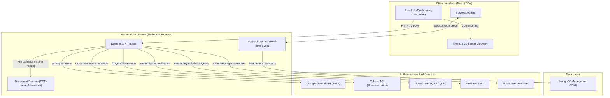

# 🧠 MindPilot: AI-Powered Smart Learning & Collaborative Study Platform

[](https://react.dev/)
[](https://nodejs.org/)
[](https://socket.io/)
[](https://threejs.org/)
[](https://www.mongodb.com/)
[](https://ai.google.dev/)

**MindPilot** is a next-generation, AI-driven educational platform designed to bridge the gap between passive reading and active, social learning. By combining multi-model Generative AI engines with interactive 3D elements and real-time multiplayer study rooms, MindPilot redefines how students study, self-assess, and collaborate.

---

## 📌 Executive Summary
Traditional digital learning platforms often leave students isolated, struggling with information overload from long study guides and PDFs. MindPilot solves this by transforming static learning materials into dynamic, interactive experiences. Whether you are generating custom interactive quizzes, querying complex research documents, studying with an on-demand AI mentor, or collaborating in real-time chatrooms with peers, MindPilot acts as a centralized flight control system for your education.

---

## 🔍 The Problem Statement
Modern students and self-learners face three primary challenges:
1. **Passive Learning Trap:** Reading pages of textbooks or PDFs leads to low retention. Active self-testing (quizzes, structured Q&A) is proven to increase recall, but manually generating these study aids is time-consuming.
2. **Cognitive Overload:** Textbooks and documentation are dense. Extracting key insights and navigating multi-page documents is inefficient.
3. **Isolation in Digital Learning:** Online students lack the collaborative synergy of study groups, leading to decreased motivation and engagement.

---

## 💡 The Solution (Value Proposition)
MindPilot addresses these core pain points by offering an all-in-one AI study copilot:
* **Instant Interactive Study Aids:** Instantly generate multiple-choice quizzes and theory questions directly from uploaded textbooks, tailored by difficulty level and question volume.
* **Document Intelligence (RAG):** Upload any PDF or DOCX and query it in real-time, receiving cited, context-aware answers without manual reading.
* **24/7 AI Mentorship:** An interactive, conversational tutor powered by advanced LLMs to explain complex concepts, solve problems, and guide learning.
* **Synchronous Peer Collaboration:** Real-time, topic-focused chatrooms allowing students to pool resources, clear doubts, and discuss academic topics with peers.

---

## 📐 Product Architecture

MindPilot employs a modern client-server architecture built on React and Express, leveraging real-time WebSockets, robust document parsing, and multi-model AI routing.



---

## 🛠️ Technology Stack

| Layer | Technology | Purpose |
| :--- | :--- | :--- |
| **Frontend UI** | **React.js (v19)** | High-performance SPA structure with responsive rendering. |
| **3D Rendering** | **Three.js & OrbitControls** | Immersive 3D AI Robot model on the main dashboard to elevate user aesthetics. |
| **Real-time** | **Socket.io** | High-concurrency WebSockets for instant messaging in collaborative study rooms. |
| **Styling** | **Vanilla CSS & Lucide Icons** | Custom glassmorphic typography, smooth animations, and premium dark-mode. |
| **Backend API**| **Node.js + Express** | Robust RESTful endpoints, file upload middlewares (Multer), and AI routes. |
| **Database** | **MongoDB + Mongoose** | Document store for structured room data, chat history, and user relations. |
| **Auth** | **Firebase Auth & Supabase** | Secure, multi-provider user authentication and secondary data access. |
| **AI Models** | **Gemini (Google), Cohere, GPT (OpenAI)** | Multi-LLM setup for specialized tasks (Explaining, Summarizing, and Assessment). |
| **File Engines**| **PDF-parse & Mammoth** | On-the-fly text extraction from PDF and DOCX files. |

---

## 🌟 Key Features & Product Walkthrough

### 🚀 1. Immersive 3D Dashboard
The homepage is styled with deep, space-like dark gradients and glassmorphism. It features an interactive, auto-rotating 3D AI Robot powered by **Three.js** to give recruiters and users a stunning visual first impression.

### 📄 2. Doc Pilot & Chat with PDF
* **Doc Pilot:** Upload research papers, PDFs, or Word documents and receive categorized, clear bullet-point summaries of key concepts.
* **Chat with PDF:** Ask questions directly to your documents. The backend parses the document buffer, runs text extraction, and uses AI context matching to retrieve direct answers from your text.

### 📝 3. Mind Quiz & MindQuestions
* **Mind Quiz:** Practice multiple-choice questions on any subject. Generates structured questions with instant answers, tracking your scores in real-time.
* **MindQuestions:** Generate theory and short-answer questions tailored to specific marks and difficulty levels, assisting in exam prep.

### 💬 4. Mind Mentor
Your personalized, 24/7 academic advisor. Whether explaining a line of code, solving a math problem, or breaking down macroeconomics, the AI tutor maintains conversational context to guide students.

### 👥 5. Collaborative Study Chatrooms
* Instant creation of academic or subject-based rooms.
* Real-time synchronous message broadcasting via **Socket.io**.
* Persistent chat histories stored in **MongoDB** so you never lose track of shared student knowledge.

---

## ⚙️ Installation & Local Setup

To set up the project locally on your machine, follow these steps:

### Prerequisites
* **Node.js** (v18 or higher recommended)
* **MongoDB** (local installation or Atlas cluster URL)
* **API Keys** for Google Gen AI, Cohere, and OpenAI

### 1. Clone the Repository
```bash
git clone https://github.com/ByteMeHard-21/Mindpilot.git
cd Mindpilot
```

### 2. Configure Environment Variables
Create a `.env` file in the root directory and a `.env` file in the `backend/` directory based on the following configurations:

**Root `.env` Configuration:**
```env
REACT_APP_FIREBASE_API_KEY=your_firebase_api_key
REACT_APP_FIREBASE_AUTH_DOMAIN=your_firebase_auth_domain
REACT_APP_FIREBASE_PROJECT_ID=your_firebase_project_id
REACT_APP_FIREBASE_STORAGE_BUCKET=your_firebase_storage_bucket
REACT_APP_FIREBASE_MESSAGING_SENDER_ID=your_firebase_messaging_sender_id
REACT_APP_FIREBASE_APP_ID=your_firebase_app_id
```

**Backend `backend/.env` Configuration:**
```env
PORT=5000
MONGODB_URI=your_mongodb_connection_string
GEMINI_API_KEY=your_google_gemini_api_key
COHERE_API_KEY=your_cohere_api_key
OPENAI_API_KEY=your_openai_api_key
```

### 3. Install Dependencies
Install dependencies for both the frontend client and the backend server.

**For root (React Frontend):**
```bash
npm install
```

**For backend (Express Server):**
```bash
cd backend
npm install
cd ..
```

### 4. Start the Application
You will need two terminal windows to run both services:

**Terminal 1 (Backend Server):**
```bash
cd backend
npm start
```
*The server will boot up on `http://localhost:5000`.*

**Terminal 2 (React Frontend Client):**
```bash
npm start
```
*Your browser will automatically open to `http://localhost:3000`.*

---

## 📂 Project Structure

```
mind-pilot/
│
├── backend/                  # Node.js + Express backend
│   ├── controllers/          # Business logic handlers
│   ├── models/               # MongoDB Mongoose schemas (User, Room, Message)
│   ├── routes/               # Express endpoints (Auth, AI routes, Parsers)
│   ├── socket/               # Socket.io connection handlers
│   ├── uploads/              # Temp storage for document uploads
│   ├── .gitignore
│   ├── server.js             # Express entry point
│   └── package.json
│
├── public/                   # Static assets & 3D glb models
│   ├── model.glb             # 3D robot asset for dashboard rendering
│   └── index.html
│
├── src/                      # React frontend
│   ├── Contexts/             # Global contexts (Auth)
│   ├── Firebase/             # Firebase SDK client configurations
│   ├── images/               # App logos and branding graphics
│   ├── pages/                # Page components (Dashboard, ChatRoom, QAGenerator)
│   ├── styles/               # Component-specific CSS files
│   ├── App.js                # Routing & layout setup
│   └── index.js              # React entry script
│
├── .gitignore                # Global git ignore configuration
├── package.json              # Frontend scripts & dependencies
└── README.md                 # Project documentation
```

---

## 🔮 Future Product Roadmap
* **Vector Embeddings (Pinecone RAG):** Implement semantic search and context-aware indexing for PDFs to support massive textbooks with minimal tokens.
* **Study Gamification:** Peer challenges, multiplayer quizzes, and reward badges to boost student engagement.
* **Integrated Voice Channel:** WebRTC audio integration in study chatrooms for instant voice study circles.
* **Analytics Dashboard:** AI-generated progress reports showing subject mastery levels, practice history, and study metrics.

---

*Project created and maintained by [ByteMeHard-21](https://github.com/ByteMeHard-21).*
